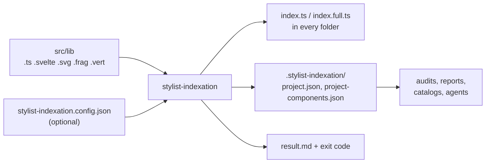
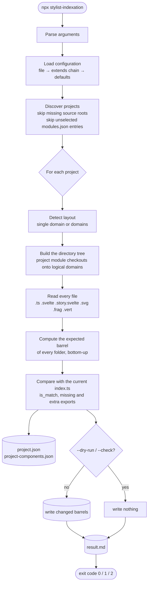
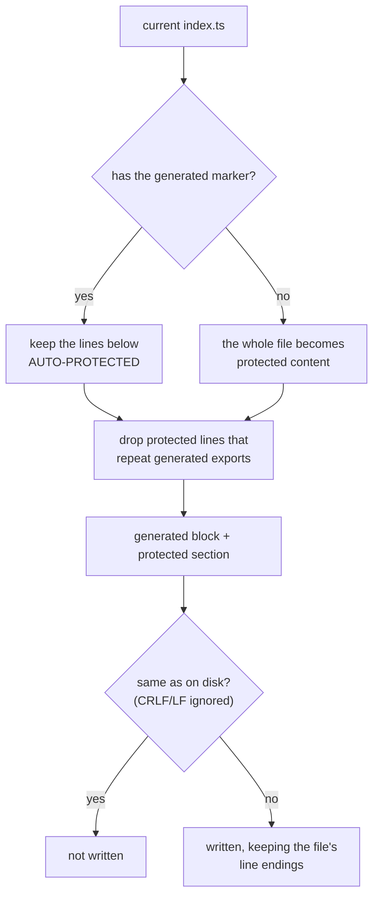
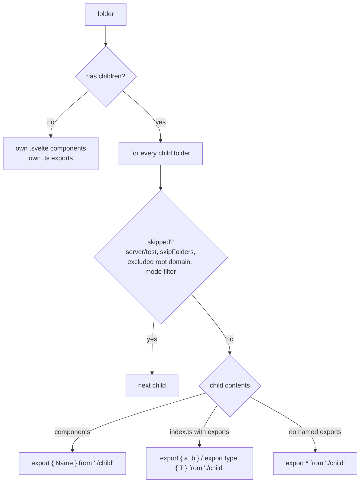
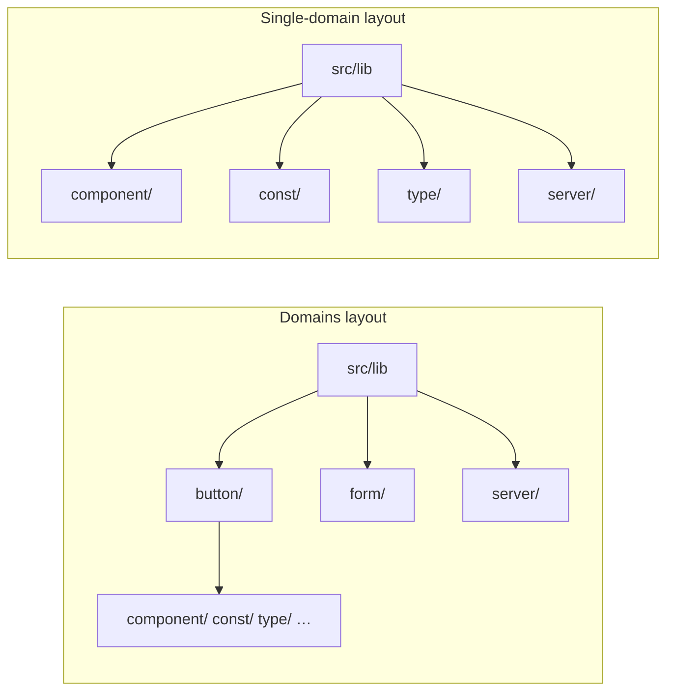
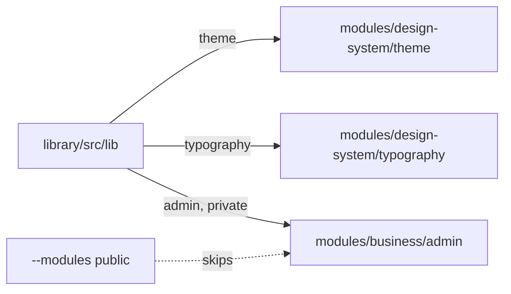
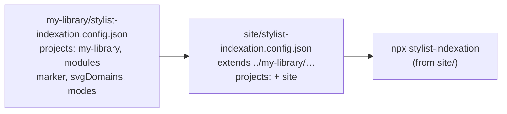

# stylist-indexation

Barrel generator and export/dependency indexer for TypeScript and Svelte.

`stylist-indexation` walks the source tree of a library or an app, reads every
TypeScript and Svelte file with the TypeScript compiler API, and does two
things:

1. **Writes barrels** — `index.ts` files that re-export everything a folder
   contains, from the deepest folder up to the source root, plus a public
   `index.ts` and a full `index.full.ts` at the root. Hand-written code in a
   barrel is kept in a protected section.
2. **Writes an index** — a JSON tree of every folder and file with its exports,
   imports, line counts and the barrel it should have, for tools that need to
   reason about the code base (architecture audits, dependency queries,
   component catalogs, AI agents).

It works with zero configuration on a plain SvelteKit `src/lib`, and scales to
multi-domain libraries split into separate module checkouts.



## Contents

- [Quick start](#quick-start)
- [How it works](#how-it-works)
- [File types](#file-types)
- [Barrels](#barrels)
- [Project layouts](#project-layouts)
- [Configuration](#configuration)
- [Command line](#command-line)
- [Output files](#output-files)
- [Programmatic use](#programmatic-use)
- [Requirements and limits](#requirements-and-limits)
- [Development](#development)

## Quick start

```bash
npm install --save-dev stylist-indexation
```

From the project root:

```bash
npx stylist-indexation --dry-run   # show which barrels would change
npx stylist-indexation             # write the barrels
npx stylist-indexation --check     # CI gate: exit 1 when a barrel is stale
```

Add the diagnostics folder to `.gitignore`:

```gitignore
.stylist-indexation/
```

Example — this source tree:

```text
src/lib/
├── components/
│   └── Button.svelte
├── utils/
│   └── format.ts        export function formatPrice(...); export type Price = number;
└── server/
    └── db.ts            export const SECRET = ...
```

gets these barrels:

```ts
// src/lib/components/index.ts
/** AREA: STYLIST CODER MODEL -> AUTO-GENERATED */
export { default as Button } from './Button.svelte';

// src/lib/utils/index.ts
/** AREA: STYLIST CODER MODEL -> AUTO-GENERATED */
export { formatPrice } from './format';
export type { Price } from './format';

// src/lib/index.ts (and index.full.ts)
/** AREA: STYLIST CODER MODEL -> AUTO-GENERATED */
export { Button } from './components';
export { formatPrice } from './utils';
export type { Price } from './utils';
```

`server` never reaches the root barrel, so server-only code cannot leak into
client bundles through `$lib`.

## How it works



1. **Configuration.** `stylist-indexation.config.json` in the launch directory
   (or `--config`) is read together with the files it `extends`. Missing keys
   take the defaults. Without a file the launch directory is the only project.
2. **Projects.** Every configured project with an existing source root is
   indexed. Projects that are checkouts of `modules.json` entries left out by
   `--modules` / `--exclude-modules` are skipped.
3. **Tree.** The source root is walked recursively. Modules declared in a
   `modules.json` next to the source root are mounted at their logical domain
   names, even when they live in another folder or repository.
4. **Analysis.** Each file is read according to its type (see below). Each
   folder gets the barrel it _should_ have, computed from its own files and the
   barrels of its children, before anything is written — so a new file deep in
   the tree reaches the root barrel in one run.
5. **Writing.** Barrels whose content differs are written; identical content
   (ignoring CRLF/LF) is never touched. In `--dry-run` and `--check` nothing in
   the sources is written.
6. **Report.** `result.md` lists the generated (or would-be generated) files.
   `--check` exits with 1 when at least one barrel is stale.

## File types

| File                                      | Read as                        | In the JSON tree                                                                                                                 | In barrels                                                        |
| ----------------------------------------- | ------------------------------ | -------------------------------------------------------------------------------------------------------------------------------- | ----------------------------------------------------------------- |
| `*.ts`, `*.svelte.ts`                     | TypeScript (compiler API)      | `ts[]`: `read.exports` (`default`, `type`, `interface`, `transit`), `read.imports` (`type`, `data`), `rows_count`, `raw_content` | named values, `export type`, interfaces, `export *` of the module |
| `index.ts`                                | TypeScript + barrel comparison | `ts[]` with `read`, `build` (expected barrel) and `merge` (`is_match`, missing/extra exports, `action`)                          | generated or updated                                              |
| `*.test.ts`, `*.spec.ts`, `*.story.ts`    | TypeScript                     | `ts[]`                                                                                                                           | never exported                                                    |
| `*.svelte`                                | Svelte component               | `svelte[]`: `read.default` (`name`, `from`), `line_count`, `raw_content`                                                         | `export { default as Name } from './file.svelte'`                 |
| `index.svelte`                            | Svelte component               | named after its folder: `date-picker/index.svelte` → `DatePicker`                                                                | `export { default as DatePicker } from './index.svelte'`          |
| `*.story.svelte`                          | Story                          | `story[]`: `line_count`, `raw_content`                                                                                           | never exported                                                    |
| `*.svg`                                   | Asset                          | `svg[]`: `rows_count`, `size_bytes`, `raw_content`                                                                               | only in `svgDomains`: glob constant and name list (below)         |
| `*.vert`, `*.frag`                        | Shader asset                   | `vert[]`, `frag[]`: `rows_count`, `size_bytes`, `raw_content`                                                                    | never exported                                                    |
| anything else (`.json`, `.md`, `.css`, …) | —                              | listed in the folder's `files`                                                                                                   | never exported                                                    |

Details:

- **TypeScript exports** are classified into buckets: values (`const`,
  `let`, destructured names, `function`, `class`, `enum`, `namespace`, default
  exports by their declared name), `type` aliases, `interface`s and
  `export * from` (transit). Values are re-exported with `export { … }`, types
  and interfaces with `export type { … }`. Re-exports keep their bucket. Names
  that cannot be re-exported by name are skipped.
- **TypeScript imports** are split into type-only imports and value imports.
- **Component names** are PascalCase of the file or folder name
  (`foo-bar` → `FooBar`). `componentPrefixes` adds a prefix per domain
  (`html` → `HtmlButton`) and `componentNames` overrides a single family.
- **SVG domains.** For every subfolder of a domain listed in `svgDomains` that
  contains SVG files, the domain barrel gets a glob constant and a typed list
  of icon names:

  ```ts
  // src/lib/svg/index.ts for src/lib/svg/icons/{add,arrow}.svg
  export const ICON_SVG_GLOB = '/src/lib/svg/icons/*.svg';

  export const ICON_SVG_NAMES = ['add', 'arrow'] as const;
  export type IconSvgName = (typeof ICON_SVG_NAMES)[number];
  ```

  The glob suits `import.meta.glob`; for a mounted module it points to the
  module checkout (`/modules/…`).

## Barrels

### Generated block and protected section

Every barrel starts with the configured marker. Anything that is not generated
— hand-written exports, comments, helpers — is moved below a protected marker
and kept on every run:

```ts
/** AREA: STYLIST CODER MODEL -> AUTO-GENERATED */
export { Button } from './button';
export type { ButtonProps } from './button';

/** AREA: STYLIST CODER MODEL -> AUTO-PROTECTED */

export { legacyButton } from './legacy';
```



Safety rules:

- A barrel without the generated marker whose line count would drop below half
  is skipped and reported as `[SKIP]`.
- An empty generated barrel is cleared only when it carries the marker.
- Lines with a `retiredMarkers` header (old generator names) are dropped.

### What a folder exports



- Leaf folders export their own components and the exports of their `.ts`
  files.
- Parent folders re-export what their children's barrels export, by name. A
  child folder whose `index.ts` is hand-written is re-exported by the names it
  declares.
- `serviceFolders` (`server`, `test`) are never re-exported; neither are
  `skipFolders`.

### Root barrels

| Source root               | `index.ts`                                                            | `index.full.ts`                      |
| ------------------------- | --------------------------------------------------------------------- | ------------------------------------ |
| Domains (several folders) | `package` mode: public clusters, without excluded and private domains | `full` mode: everything but `server` |
| Single domain (clusters)  | the selected `--generation-mode`                                      | not created                          |

A partial module selection (`--modules`, `--exclude-modules`) never rewrites
`index.full.ts`.

## Project layouts

The generator recognizes two layouts of a source root.



- **Single domain:** every folder of the source root is a root cluster
  (`rootClusters`) or a service folder, and at least one is a cluster. The
  whole root is one domain; the root barrel uses the selected mode.
- **Domains:** any other source root. Each top-level folder is a domain; the
  root gets `index.ts` (package filter) and `index.full.ts`.

Inside a domain, the mode decides which root clusters are exported
(`includedRootClusters`). Other folders are exported as plain modules; with
`clustersOnly: true` (strict SAMO layout `domain/cluster/joint/family`) they are
left out.

### modules.json and module.json

Large libraries can keep domains in separate folders or repositories. A
`modules.json` next to the source root (`<project>/modules.json` for
`<project>/src/lib`) maps module names to their checkouts:

```json
{
  "design-system": {
    "path": "modules/design-system",
    "sourceRoot": ".",
    "domains": ["theme", "typography", "svg"]
  },
  "admin": {
    "path": "modules/business/admin",
    "domainRoot": true,
    "private": true,
    "domains": ["admin"]
  }
}
```

| Field        | Meaning                                                                          |
| ------------ | -------------------------------------------------------------------------------- |
| `path`       | Checkout folder, relative to the project; must stay inside it                    |
| `domains`    | Logical domains the module provides; a domain may belong to one module only      |
| `sourceRoot` | Folder of the domains inside the checkout (default: the configured `sourceRoot`) |
| `domainRoot` | The checkout itself is the single domain                                         |
| `private`    | Domains left out of the public `index.ts`; `--modules public` skips the module   |

Selected modules are mounted at their domain names in the tree, and their
barrels import the physical paths. A module checkout can also be indexed as its
own project; a `module.json` in that checkout (`sourceRoot`, `domains`,
`domainRoot`, `private`) describes it.



## Configuration

`stylist-indexation.config.json` in the launch directory, or `--config <file>`.
Every key is optional, unknown keys are rejected, paths are relative to the
file that declares them.

```json
{
  "extends": "../my-library/stylist-indexation.config.json",
  "projects": [
    { "name": "my-library", "path": "../my-library" },
    { "name": "site", "path": "." }
  ],
  "sourceRoot": "src/lib",
  "outDir": ".stylist-indexation",
  "marker": "MY LIBRARY",
  "clustersOnly": false,
  "skipFolders": ["shader", "theme/legacy"],
  "svgDomains": ["svg"],
  "componentPrefixes": { "html": "Html" },
  "componentNames": { "html/node": "HtmlNodeRenderer" }
}
```

| Key                 | Default                                              | Meaning                                                                    |
| ------------------- | ---------------------------------------------------- | -------------------------------------------------------------------------- |
| `extends`           | —                                                    | Base configuration; its projects come first, maps are merged               |
| `projects`          | the config directory (named after `package.json`)    | `{ name, path }` of every indexed project                                  |
| `sourceRoot`        | `src/lib`                                            | Source folder inside a project; must be below it                           |
| `rootClusters`      | `class component const data function interface type` | Folders that make a source root a single domain                            |
| `serviceFolders`    | `server test`                                        | Other folders allowed at a domain root; never exported                     |
| `clustersOnly`      | `false`                                              | Strict layout: domain folders that are not root clusters stay out          |
| `modes`             | `full`, `package` (below)                            | `{ excludedRootDomains, includedRootClusters }` per `--generation-mode`    |
| `marker`            | `STYLIST CODER MODEL`                                | Barrel header `/** AREA: <marker> -> AUTO-GENERATED */`                    |
| `retiredMarkers`    | `[]`                                                 | Former header labels dropped from protected sections                       |
| `outDir`            | `.stylist-indexation`                                | Diagnostics folder                                                         |
| `skipFolders`       | `[]`                                                 | Never re-exported: `name` anywhere, `parent/path/name` below that path     |
| `svgDomains`        | `[]`                                                 | Domains whose SVG folders get glob constants and name lists                |
| `componentPrefixes` | `{}`                                                 | Component name prefix per domain                                           |
| `componentNames`    | `{}`                                                 | Exact component name per `domain/family`                                   |
| `aliases`           | `["$lib"]`                                           | Import aliases resolved against the source root by `DependencyBushBuilder` |

Built-in modes (a config may override them or add new ones):

| Mode      | Excluded root domains | Exported root clusters                               |
| --------- | --------------------- | ---------------------------------------------------- |
| `full`    | `server`              | `class component const data function interface type` |
| `package` | `server`              | `component const interface type`                     |

`package` additionally excludes every `private` domain of `modules.json`.

### Sharing a configuration

A library keeps its rules in its own file; every app that indexes the library
from its own folder extends it and adds itself:



## Command line

```text
stylist-indexation [options]
```

| Option                            | Effect                                          |
| --------------------------------- | ----------------------------------------------- |
| `--config <file>`                 | Configuration instead of the default file name  |
| `--out-dir <dir>`                 | Diagnostics folder instead of `outDir`          |
| `--generation-mode <mode>`        | Configured mode, `full` by default              |
| `--modules all\|public\|name,...` | Selected `modules.json` entries                 |
| `--exclude-modules name,...`      | Exclusions after the selection                  |
| `--projects name,...`             | Only these configured projects                  |
| `--dry-run`                       | Compute and report without writing source files |
| `--check`                         | Dry run; exit 1 when a barrel is stale          |
| `--help`                          | Usage                                           |

Values may also be written as `--option=value`.

| Exit code | Meaning                                                                    |
| --------- | -------------------------------------------------------------------------- |
| `0`       | Success (or `--check` found nothing stale)                                 |
| `1`       | `--check` found stale barrels, unknown `--projects`, or a generation error |
| `2`       | Invalid arguments or configuration                                         |

Typical CI step:

```yaml
- run: npx stylist-indexation --check
```

## Output files

Written to `outDir` (`dry-run/` inside it for `--dry-run` and `--check`):

| File                        | Content                                                                 |
| --------------------------- | ----------------------------------------------------------------------- |
| `<project>-components.json` | Raw directory tree: `name`, `path`, `files`, `children`                 |
| `<project>.json`            | Enriched tree: the raw tree plus per-file analysis and expected barrels |
| `result.md`                 | List of generated (or would-be generated) barrels                       |

Shape of an enriched folder node:

```jsonc
{
  "name": "button",
  "path": "/abs/src/lib/button",
  "architecture_path": "/abs/src/lib/button", // logical path of mounted modules
  "files": ["Button.svelte", "index.ts", "types.ts"],
  "children": [],
  "svelte": [
    {
      "read": {
        "file": "Button.svelte",
        "default": { "name": "Button", "from": "./Button.svelte" },
      },
    },
  ],
  "ts": [
    {
      "read": {
        "file": "types.ts",
        "exports": { "type": [{ "name": "ButtonProps", "from": "..." }] },
      },
    },
    {
      "read": { "file": "index.ts", "exports": {} },
      "build": {
        "exports": {},
        "raw_content": "/** AREA: … */\nexport { default as Button } …",
      },
      "merge": {
        "is_match": false,
        "missing_exports": [],
        "action": "update_required",
      },
    },
  ],
}
```

`merge.action` is `update_required` or `no_update_needed` for every folder, so
the JSON alone tells which barrels are out of date.

## Programmatic use

```ts
import { IndexationCli } from 'stylist-indexation';
import { IndexationConfigRepository } from 'stylist-indexation/class/repository/indexation-config';
import type { IndexationConfig } from 'stylist-indexation/interface/contract/indexation-config';

const config: IndexationConfig = IndexationConfigRepository.load(process.cwd());
console.log(config.projects);

// Same as the CLI; returns the exit code. The third argument overrides outDir.
const code = IndexationCli.main(['--check'], process.cwd());
```

The root export is the CLI facade. Every other entity is published under its
path inside the package, `stylist-indexation/<cluster>/<joint>/<family>`, with
type declarations. The root export and `interface/contract/*` follow semantic
versioning; other paths are internal and may change in minor versions.

## Requirements and limits

- Node.js 22 or newer. The only runtime dependency is `typescript`.
- The source root must be a folder below the project (`src/lib`, `src/app`, …),
  not the project folder itself.
- `.svelte` files are exported as components by their file or folder name;
  named exports from `<script module>` are not read.
- Folder and `.ts` re-exports are relative and extensionless (`'./button'`),
  as SvelteKit and bundlers resolve them; components keep `.svelte`.
- Run order matters only through the files on disk: the generator never reads
  its previous JSON output.

## Development

```bash
git clone https://github.com/Godmy/stylist-indexation.git
cd stylist-indexation
npm ci
npm run check      # TypeScript
npm test           # Vitest
npm run build      # dist/ for the npm package
```

Node 24.11+ can run the CLI straight from the sources without a build:
`node ../stylist-indexation/scripts/indexation.mjs`. Source conventions are in
[AGENTS.md](AGENTS.md), the internal flow in
[src/lib/indexation/README.md](src/lib/indexation/README.md), releases in
[CHANGELOG.md](CHANGELOG.md).

## History

The generator started as a Python script of the `stylist-svelte` component
library, was ported to TypeScript in `stylist-svelte-tools`, and became this
standalone package. Python compatibility was dropped in 1.0.0.

## License

[MIT](LICENSE)
