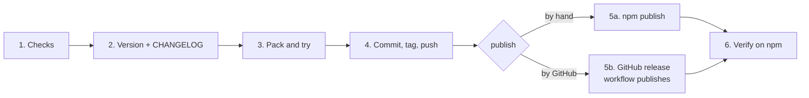

# Releasing

Checklist for publishing `stylist-indexation` to npm and GitHub.



## One-time setup

1. npm account with two-factor authentication: <https://www.npmjs.com/signup>.
2. Log in on this machine: `npm login`, check with `npm whoami`.
3. Publish the very first version by hand (step 5a): a granular token can be
   limited to a package only after the package exists.
4. For releases from GitHub (step 5b): create an npm **automation** access
   token (npmjs.com → Access Tokens → Generate New Token → Granular, read and
   write for `stylist-indexation`) and save it in the repository as the secret
   `NPM_TOKEN` (GitHub → Settings → Secrets and variables → Actions). Instead
   of a token you can configure npm _trusted publishing_ for the repository
   and the `publish.yml` workflow.
5. The repository must be public for `--provenance`.

## Every release

1. **Checks** — on a clean `main`:

   ```bash
   git pull
   npm ci
   npm run check
   npm run format:check
   npm test
   npm run build
   ```

2. **Version** — move the `## x.y.z — unreleased` heading of `CHANGELOG.md` to
   the release date, then:

   ```bash
   npm version patch   # or minor / major; creates a commit and a vX.Y.Z tag
   ```

   The first release, `1.0.0`, was tagged `v1.0.0` by hand.

3. **Pack and try**:

   ```bash
   npm pack --dry-run          # contents: bin, dist, src (no tests), README, LICENSE, CHANGELOG
   npm pack                    # stylist-indexation-x.y.z.tgz
   ```

   In any other project: `npm i -D path/to/stylist-indexation-x.y.z.tgz` and
   run `npx stylist-indexation --dry-run`. Delete the `.tgz` afterwards.

4. **Push**:

   ```bash
   git push
   git push --tags
   ```

5. **Publish** — one of:

   - **a. By hand**: `npm publish` (runs check, tests and build through
     `prepublishOnly` / `prepack`; npm asks for the 2FA code).
   - **b. From GitHub**: GitHub → Releases → Draft a new release → choose the
     tag → paste the changelog section → Publish. The `Publish` workflow runs
     `npm publish --provenance --access public`.

6. **Verify**:

   ```bash
   npm view stylist-indexation version
   npx stylist-indexation@latest --help
   ```

## If something goes wrong

- A broken version can be deprecated, not reused:
  `npm deprecate stylist-indexation@x.y.z "reason"`, then release a fix.
- `npm unpublish` works only within 72 hours and blocks the version number
  forever; prefer `deprecate`.
