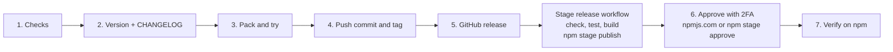

# Releasing

Checklist for publishing `stylist-indexation` to npm through GitHub and npm
[staged publishing](https://docs.npmjs.com/staged-publishing/): GitHub builds
and stages the release, a maintainer approves it with 2FA, and only then it
becomes installable.



## One-time setup

1. npm account with two-factor authentication, maintainer of
   `stylist-indexation`.
2. npm CLI 11.15 or newer on this machine for `npm stage` commands:
   `npm install --global npm@11`, check with `npm -v`. (npm 12 needs
   Node.js 22.22.2+ or 24.15+.) Then `npm login`, check with `npm whoami`.
3. Trusted publisher on npmjs.com: package `stylist-indexation` → **Settings**
   → **Trusted Publisher** → **GitHub Actions**:
   - Organization or user: `Godmy`
   - Repository: `stylist-indexation`
   - Workflow filename: `publish.yml`
   - Environment: leave empty
   - **Allowed actions**: keep only staged publishing (`npm stage publish` is
     always allowed); do not allow direct `npm publish`.

   No npm token is stored in GitHub; delete an old `NPM_TOKEN` secret if
   there is one.

4. Recommended: package **Settings** → **Publishing access** → _Require
   two-factor authentication and disallow tokens_.

## Every release

1. **Checks** — on a clean `main`:

   ```bash
   git pull
   npm ci
   npm run check
   npm run format:check
   npm test
   npm run build
   ```

2. **Version** — move the `## x.y.z — unreleased` heading of `CHANGELOG.md` to
   the release date, commit it, then:

   ```bash
   npm version patch   # or minor / major; creates a commit and a vX.Y.Z tag
   ```

3. **Pack and try**:

   ```bash
   npm pack --dry-run          # contents: bin, dist, src (no tests), README, LICENSE, CHANGELOG
   npm pack                    # stylist-indexation-x.y.z.tgz
   ```

   In any other project: `npm i -D path/to/stylist-indexation-x.y.z.tgz` and
   run `npx stylist-indexation --dry-run`. Delete the `.tgz` afterwards.

4. **Push**:

   ```bash
   git push
   git push --tags
   ```

5. **GitHub release** — GitHub → **Releases** → **Draft a new release** →
   choose the `vX.Y.Z` tag → paste the changelog section → **Publish
   release**. The **Stage release** workflow (`publish.yml`) checks, tests,
   builds and runs `npm stage publish`; provenance is added automatically.
   Watch it under **Actions**.

6. **Approve** — after the workflow succeeds and npm finishes its automated
   validation:

   - **npmjs.com**: **Staged Packages** tab → review `stylist-indexation@x.y.z`
     → **Approve** → 2FA.
   - **or the CLI**:

     ```bash
     npm stage list stylist-indexation
     npm stage view <stage-id>          # optional review
     npm stage download <stage-id>      # optional: inspect the tarball
     npm stage approve <stage-id>       # asks for 2FA
     ```

   A staged version that should not ship is rejected on npmjs.com; fix it and
   release the next patch version.

7. **Verify**:

   ```bash
   npm view stylist-indexation version
   npx stylist-indexation@latest --help
   ```

## Without GitHub

If the workflow is unavailable, stage from a clean checkout of the tag:
`npm stage publish` (builds through `prepack`), then approve as in step 6.
Direct `npm publish` also works while the package allows it.

## If something goes wrong

- A failed workflow stages nothing: fix, move the tag only if the release was
  never approved, or release the next patch version.
- A broken version can be deprecated, not reused:
  `npm deprecate stylist-indexation@x.y.z "reason"`, then release a fix.
- `npm unpublish` works only within 72 hours and blocks the version number
  forever; prefer `deprecate`.
