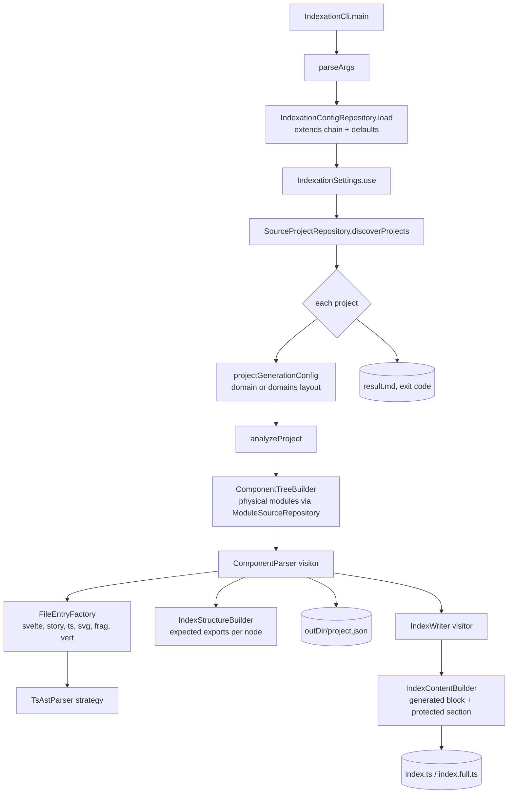

# indexation

Index generator for TypeScript and Svelte sources: `index.ts` /
`index.full.ts` barrels, protected sections and the enriched-tree JSON of
exports, imports and dependencies. Projects, source root, clusters, filters and
naming rules come from `stylist-indexation.config.json`
([IndexationConfig](interface/contract/indexation-config/index.ts)); without
the file the launch directory is the only project.

```powershell
# from the project root
node ../stylist-indexation/scripts/indexation.mjs --check
node ../stylist-indexation/scripts/indexation.mjs           # writes barrels
```

| Flag                              | Effect                                    |
| --------------------------------- | ----------------------------------------- |
| `--config <file>`                 | Configuration instead of the default name |
| `--out-dir <dir>`                 | Diagnostics directory instead of `outDir` |
| `--generation-mode <mode>`        | Configured mode, `full` by default        |
| `--modules all\|public\|name,...` | Selected `modules.json` entries           |
| `--exclude-modules name,...`      | Exclusions after selection                |
| `--projects name,...`             | Only these configured projects            |
| `--dry-run`                       | Compute without writing barrels           |
| `--check`                         | Dry run; exit 1 when barrels are stale    |

Diagnostics: `<outDir>/<project>.json` (enriched tree),
`<project>-components.json` (raw tree) and `result.md`; `dry-run/` for
`--dry-run` and `--check`.

## Flow



## Generation rules

- A source root whose folders are domains gets a public `index.ts` (the
  `package` mode filter, private `modules.json` domains excluded) and a full
  `index.full.ts`; a partial module selection never touches the full root.
  Internal domain barrels always stay complete. A source root whose folders are
  root clusters (`rootClusters`, plus `serviceFolders`) is a single domain.
- Missing barrels are computed bottom-up in memory, so a new `class/index.ts`
  reaches the root barrel in the same pass.
- The generated block starts with `/** AREA: <marker> -> AUTO-GENERATED */`.
  Existing `AUTO-PROTECTED` content is kept at the end; a fully manual barrel
  becomes protected content below the generated block. Lines of
  `retiredMarkers` headers are dropped.
- `*.story.ts`, `*.test.ts`, `*.spec.ts` are analyzed but never exported.
  Components of `componentPrefixes` domains get the prefix;
  `componentNames` overrides single families.
- Folders of `svgDomains` get glob constants and name lists of their SVG files.
- Unchanged content (CRLF/LF normalized) is not rewritten; a rewritten barrel
  keeps its line endings, new files use LF.
- Exports and imports are read with the TypeScript compiler API (`TsAstParser`).

## Clusters

- [const](const/README.md): defaults, configuration file name, environment names.
- [type](type/README.md): JSON record and export bucket aliases.
- [interface](interface/README.md): configuration, trees, file entries and exports.
- [class](class/README.md): the generator itself, by design-pattern role.
- [function](function/README.md): `analyzeProject`.
- [test](test/README.md): generation, configuration and parser suites.
